# Hi 👋, I'm Kanji

### 📊 GitHub Stats

### 🐍 Contribution Snake

  <picture>
    <source media="(prefers-color-scheme: dark)"
            srcset="https://raw.githubusercontent.com/Komari-Koshigaya/Komari-Koshigaya/output/snake-dark.svg">
    
  </picture>

### 🚀 Recent Projects
<!-- RECENT-PROJECTS:START -->
- [gitcode-npusim-review](https://github.com/Komari-Koshigaya/gitcode-npusim-review) — Daily automated code review of gitcode.com/cann/npu-simulator PRs, with HTML reports on GitHub Pages 2026-11-28
- [chromeScripts](https://github.com/Komari-Koshigaya/chromeScripts) — 个人油猴 (Tampermonkey) 脚本合集 2026-09-26
- [duplicate-cleaner](https://github.com/Komari-Koshigaya/duplicate-cleaner) — Duplicate file finder and cleaner with GUI - 基于内容哈希的重复文件查找清理工具 2026-06-23
- [media-server](https://github.com/Komari-Koshigaya/media-server) — 局域网媒体服务器 2026-06-21
- [general-command](https://github.com/Komari-Koshigaya/general-command) — Some general commands and usages about git 、docker、linux and so on. 2022-03-07
<!-- RECENT-PROJECTS:END -->

---
### 🛠️ Tech Stack
Java | Python | JavaScript | Linux | WSL

### Recent Updates

<!--
**Komari-Koshigaya/Komari-Koshigaya** is a ✨ _special_ ✨ repository because its `README.md` (this file) appears on your GitHub profile.

Here are some ideas to get you started:

- 🔭 I’m currently working on ...
- 🌱 I’m currently learning ...
- 👯 I’m looking to collaborate on ...
- 🤔 I’m looking for help with ...
- 💬 Ask me about ...
- 📫 How to reach me: ...
- 😄 Pronouns: ...
- ⚡ Fun fact: ...
-->

- 🌱 I’m currently learning ...

  
<b>:telescope: 2020 goal</b>

  I want to make more friends. 
  - ⚡ Interests: アニメ　白い巨塔
  
  
  
  
  

